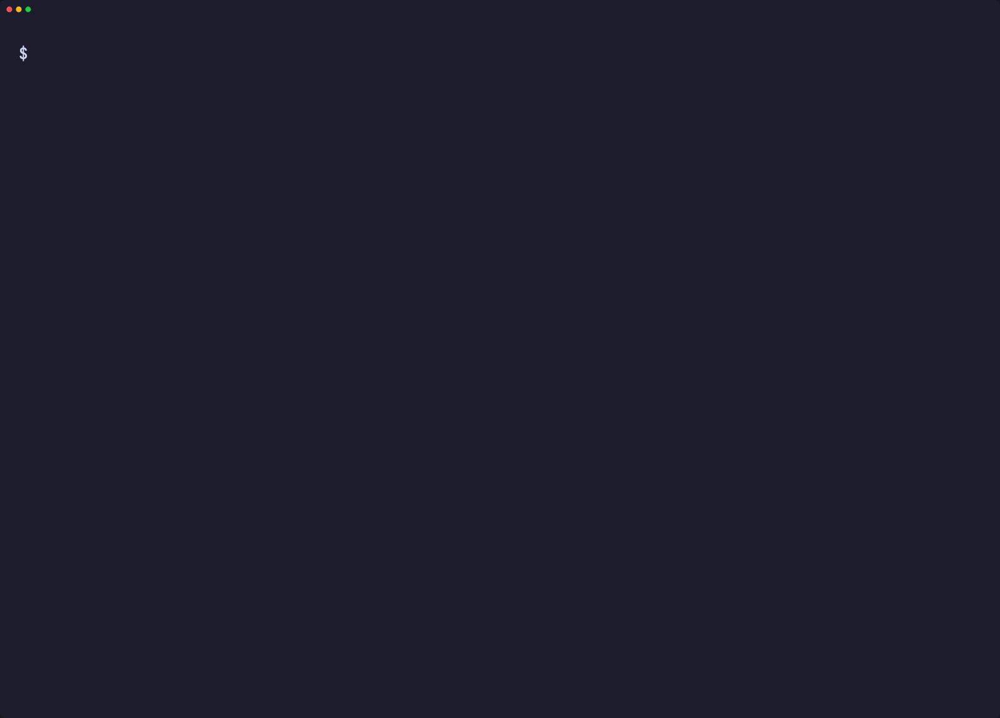
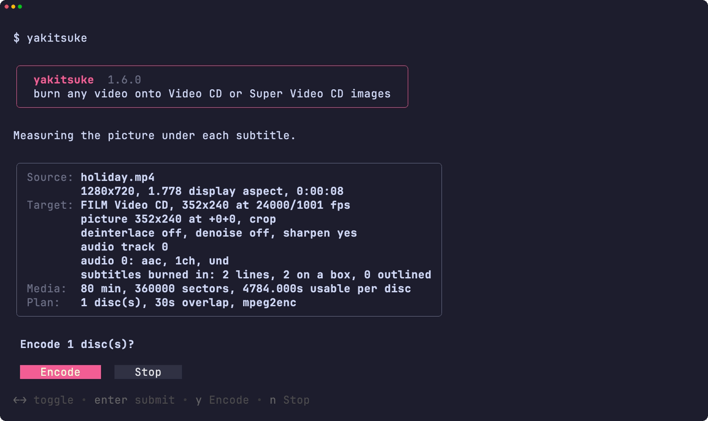
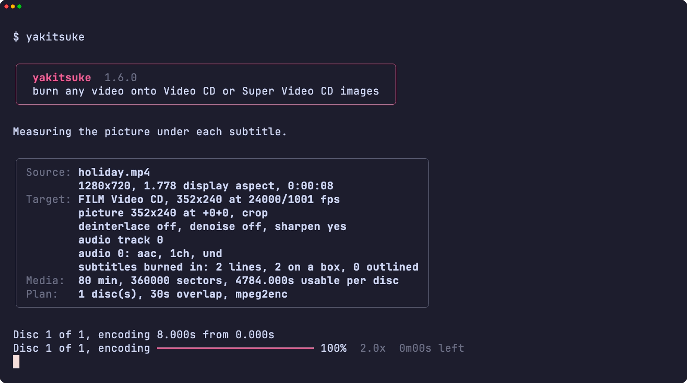
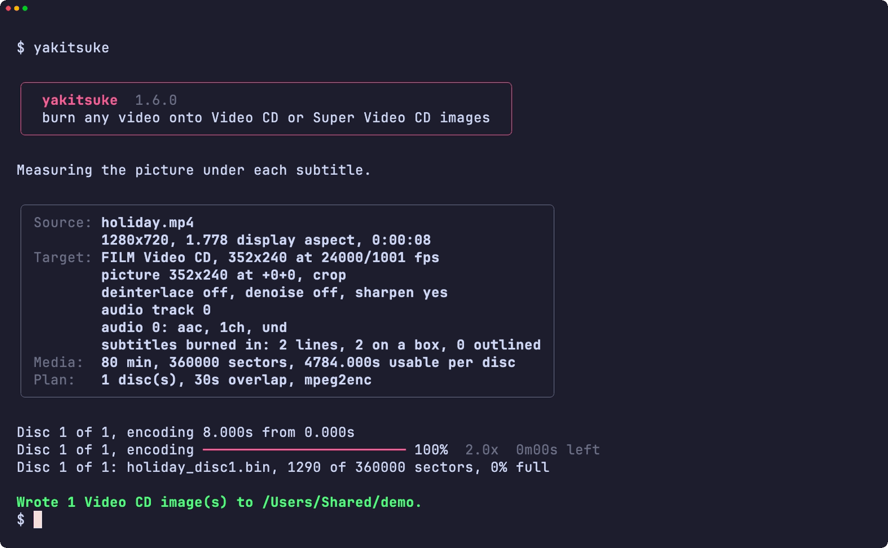
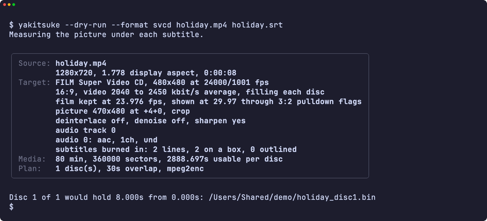
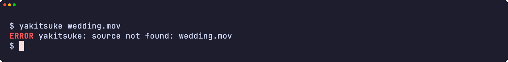
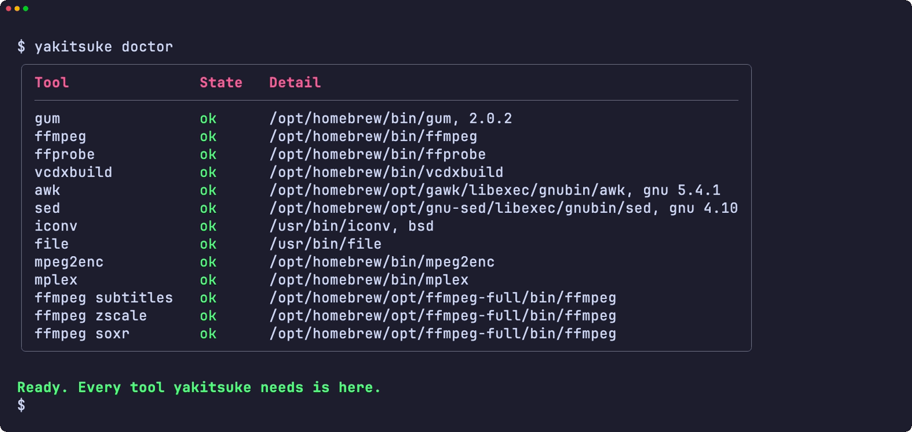
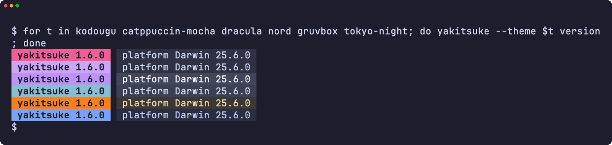
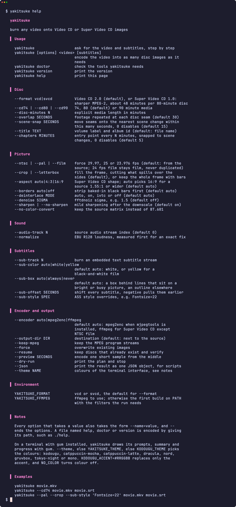

<div align="center">

<h1>yakitsuke</h1>

<strong>あらゆる動画をビデオ CD またはスーパービデオ CD のイメージに変換し、複数のディスクに分割します。字幕はどんな映像の上でも読みやすく保たれます。</strong>

[English](README.md) | 日本語 | [简体中文](README.zh-Hans.md) | [繁體中文 (香港)](README.zh-HK.md)

[](https://github.com/gufranco/yakitsuke/actions/workflows/ci.yml)
[](https://github.com/gufranco/yakitsuke/releases/latest)
[](LICENSE)

<p align="center">
  <a href="#quick-start"><strong>クイックスタート</strong></a> |
  <a href="#picture">画質</a> |
  <a href="#subtitles">字幕</a> |
  <a href="#development">開発</a>
</p>

</div>

コマンドは一つ、テストは 264 件、シェルモジュールは 12 個。POSIX システム、gum、操作する映像ツール以外に実行時の依存はありません。`yakitsuke` は「焼き付け」です。映画を CD に焼き、字幕を映像に焼き付けます。姉妹ツールの [kakikomi](https://github.com/gufranco/kakikomi) と [kiyome](https://github.com/gufranco/kiyome) はディスクの書き込みと消去を行います。

---

<p align="center">
  
</p>

```console
$ yakitsuke --output-dir ~/Movies trailer.mp4 trailer.srt
Measuring the picture under each subtitle.

Source: trailer.mp4
        1920x1080, 2.400 display aspect, 0:00:20
        black bars stripped, active picture 1920x800 at +0+140
Target: FILM Video CD, 352x240 at 24000/1001 fps
        picture 352x240 at +0+0, crop
        deinterlace off, denoise off, sharpen yes
        audio track 0
        audio 0: aac, 1ch, und
        subtitles burned in: 4 lines, 4 on a box, 0 outlined
Media:  80 min, 360000 sectors, 4784.000s usable per disc
Plan:   1 disc(s), 30s overlap, mpeg2enc

Disc 1 of 1, encoding 20.000s from 0.000s
Disc 1 of 1, encoding  17%  7.0x  0m02s left
Disc 1 of 1, encoding  44%  4.4x  0m02s left
Disc 1 of 1, encoding  64%  4.3x  0m01s left
Disc 1 of 1, encoding  85%  4.2x  0m00s left
Disc 1 of 1, encoding  93%  4.1x  0m00s left
Disc 1 of 1, encoding 100%  3.9x  0m00s left
Disc 1 of 1: trailer_disc1.bin, 2187 of 360000 sectors, 0% full
Wrote 1 Video CD image(s) to ~/Movies.
```

<a id="quick-start"></a>

## クイックスタート

### 必要なもの

| ツール | 用途 | インストール |
|:-----|:----|:--------|
| [`gum`](https://github.com/charmbracelet/gum) | 端末の画面：メニュー、入力、表、配色 | `brew install gum`。Homebrewのformulaが自動でインストールします |
| libass と zimg を含む `ffmpeg` | デコード、フィルタ、字幕、16 ビット色変換 | `brew install ffmpeg-full`、または `apt install ffmpeg` |
| `vcdimager` | VCD 2.0 または SVCD 1.0 の BIN/CUE イメージを作成 | `brew install vcdimager`、または `apt install vcdimager` |
| `mjpegtools` | より高画質な MPEG-1 エンコーダの `mpeg2enc` と `mplex` | `brew install mjpegtools`、または `apt install mjpegtools` |

`mjpegtools` がない場合は ffmpeg のエンコーダに切り替え、その旨を表示します。`yakitsuke doctor` でインストール状況を確認できます。

### インストール

```bash
brew install gufranco/tap/yakitsuke
```

ソースからの場合:

```bash
git clone https://github.com/gufranco/yakitsuke.git
cd yakitsuke
make install
```

`make install` はツールとフォント、man ページ、bash・zsh・fish の補完を `~/.local` に配置し、`yakitsuke` を `~/.local/bin` に置きます。場所は `PREFIX` で変更できます。Homebrew の formula も同じファイルをインストールします。

### 確認

```console
$ yakitsuke doctor
gum                ok       /opt/homebrew/bin/gum, 2.0.2
ffmpeg             ok       /opt/homebrew/bin/ffmpeg
ffprobe            ok       /opt/homebrew/bin/ffprobe
vcdxbuild          ok       /opt/homebrew/bin/vcdxbuild
awk                ok       /usr/bin/awk, bsd 20200816
sed                ok       /usr/bin/sed, bsd
iconv              ok       /usr/bin/iconv, bsd
file               ok       /usr/bin/file
mpeg2enc           ok       /opt/homebrew/bin/mpeg2enc
mplex              ok       /opt/homebrew/bin/mplex
ffmpeg subtitles   ok       /opt/homebrew/opt/ffmpeg-full/bin/ffmpeg
ffmpeg zscale      ok       /opt/homebrew/opt/ffmpeg-full/bin/ffmpeg
```

## 使い方

| コマンド | 目的 |
|:--------|:--------|
| `yakitsuke [options] <video> [subtitles]` | 必要な枚数のディスクイメージに動画をエンコード |
| 引数なしの `yakitsuke` | 端末で実行すると、動画と字幕ファイルを尋ねる |
| `yakitsuke doctor` | 必要なツールとインストール状況を一覧表示 |
| `yakitsuke version`、`yakitsuke help` | バージョンまたは使い方の全文を表示 |

| オプション | 効果 |
|:-------|:-------|
| `--format vcd\|svcd` | 既定のビデオ CD、またはスーパービデオ CD。より鮮明な MPEG-2 で、1 枚あたり約 48 分 |
| `--aspect auto\|4:3\|16:9` | スーパービデオ CD の画面比。`auto` は 1.55:1 以上の素材に 16:9 を選ぶ |
| `--cd74`、`--cd80`、`--cd90`、`--disc-minutes N` | メディアの容量。既定は 80 分 |
| `--overlap SECONDS` | ディスクの継ぎ目で重複させる秒数。既定は 30 |
| `--scene-snap SECONDS` | 継ぎ目とチャプターを最も近いシーンチェンジへ移動 |
| `--chapters MINUTES` | 数分ごとのエントリーポイント。既定は 5 |
| `--ntsc`、`--pal`、`--film` | 29.97、25、23.976 fps を強制 |
| `--crop`、`--letterbox` | 横長の映像の左右を切って画面いっぱいにする（既定）か、黒帯付きで全体を残すか |
| `--sub-color auto\|white\|yellow` | 字幕の色 |
| `--sub-box auto\|always\|never` | 字幕の背景ボックス |
| `--sub-track N`、`--sub-offset SECONDS` | 内蔵トラックの焼き付け、全行のタイミング移動 |
| `--preview SECONDS`、`--dry-run` | 短いサンプルだけをエンコード、または計画だけを表示 |
| `--json` | 結果を1つのJSONオブジェクトとして出力します（スクリプト向け） |
| `--theme <name>` | 端末の画面の配色 |
| `--resume`、`--force` | 完成済みのディスクを残すか、上書きするか |

```bash
yakitsuke movie.mkv movie.srt                  # フィルムはフィルムのまま、字幕は行ごとに調整
yakitsuke --cd74 --pal movie.mkv               # フィルムから PAL: 4% 速め、音程は維持
yakitsuke --format svcd movie.mkv movie.srt    # スーパービデオ CD、横長の映画は 16:9
yakitsuke --preview 30 movie.mkv movie.srt     # まず 30 秒で見た目を確認
yakitsuke --resume movie.mkv movie.srt         # 中断した処理を完了
```

`--overlap=10` の形も使え、`--` でオプションが終わります。yakitsuke はファミリー共通のコマンドライン規約に従います。内容は [FAMILY.md](FAMILY.md) にあります。`YAKITSUKE_FORMAT=svcd` でスーパービデオ CD が既定になります。

### テーマ

`gum`がインストールされた端末では、yakitsukeはメニュー、入力、表、メッセージをgumで描きます。パイプやスクリプトでは、出力はプレーンテキストのままです。配色は`--theme`、なければ`YAKITSUKE_THEME`、なければ`KODOUGU_THEME`で選びます。最後のものはkodouguのすべてのツールが共有します：`kodougu` （既定）、`catppuccin-mocha`、`catppuccin-latte`、`dracula`、`nord`、`gruvbox`、`tokyo-night`、`mono`。`KODOUGU_ACCENT=#RRGGBB`はアクセント色だけを置き換え、`NO_COLOR`は色を消します。

```bash
export KODOUGU_THEME=catppuccin-mocha
```

<a id="picture"></a>

## 画質

以下の選択はすべて、標準テストクリップ 20 本とパブリックドメインの映画で、表示サイズに拡大した VMAF で測定しました。

| 段階 | 選択 | 理由 |
|:------|:-------|:----|
| ビデオ CD のエンコーダ | TMPGEnc の量子化マトリクスを使う `mpeg2enc` | ffmpeg のエンコーダとの差はマトリクスが生む。TMPGEnc は VCD の基準となったエンコーダ |
| 単位係数の除去 | `-E -10` | VMAF +0.97、PSNR +0.27 dB、20 本すべてで向上 |
| フィルム | 23.976 fps の NTSC Film。29.97 への複製はしない | 同じフレームで VMAF +7.6、ジャダーなし |
| フィルムから PAL | 音程を保った 4% の速度アップ | 毎秒フレームを複製する代わりの、PAL の慣習 |
| テレシネ素材 | 逆テレシネ | 補間ではなく元のフィルムフレームを復元 |
| スケーリング | 16 ビットの Lanczos、BT.601、誤差拡散ディザ | 再量子化は最後の一回だけ |
| シャープ化 | 縮小後、黒帯を付ける前に弱いアンシャープ | リンギングが黒帯の境に届かない |
| 黒帯 | 最初に検出して除去 | 焼き込まれた枠にビットを使わない |
| スーパービデオ CD のエンコーダ | ffmpeg。NTSC のフィルムだけは別 | 同じサイズで `mpeg2enc` より VMAF 2 から 4.4 高い。フィルムでは `mpeg2enc` が 23.976 fps と 3:2 プルダウンフラグを保ち、最大 VMAF +1.4、ジャダーなし |
| スーパービデオ CD のレート | ディスクが埋まるまで 1 枚ごとに上げ、ピークは 2516 kbit/s のまま | `mpeg2enc -q 1` は目標レートの 1.3% 以内に収まり、`-t` だけより VMAF +2.6 から +3.9 |
| スーパービデオ CD の画面比 | 1.55:1 以上の素材は 16:9。有効な 704 サンプルを 480 のうち 470 に収める | 円のテストパターンが BT.601 のプレーヤーで 1.004:1 になる |
| インターレース素材 | 高さの拡縮が不要ならスーパービデオ CD ではフィールドを保ち、1 フィールドずつシャープ化 | デインターレースより VMAF +7.2、どのフィールドの動きも残る |

成功を報告する前に、すべてのストリームはビデオ CD またはスーパービデオ CD 規格への適合を、すべてのイメージはメディア容量を確認します。

<a id="subtitles"></a>

## 字幕

焼き付けた字幕は視聴者が変更できないため、各行を下の映像に合わせてスタイル付けします。規則は BBC の字幕ガイドラインと WCAG のコントラスト基準に従います。

| 判断 | 規則 |
|:---------|:-----|
| ボックスか縁取りか | 各行の下の映像を測定します。明るい映像や、文字と競うほど細かい映像では、BBC の指定どおり行ごとに不透明度 85% の黒いボックスを付けます。それ以外は映像を隠しにくい縁取りと影を使います |
| しきい値 | 90 パーセンタイル輝度が白文字の 4.5:1 コントラストを超えるとき、またはエッジ密度が 8% を超えるときにボックス |
| 色 | 放送と配信の標準である白。白黒映画では白文字が映像に溶け込むため黄色 |
| フォント | 弱視の人の読みやすさのために設計された Atkinson Hyperlegible。SIL Open Font License で同梱 |
| サイズ | 1 行あたり映像の高さの 7.5%。BBC が 4:3 に認める幅 90% の範囲内 |
| 長い行 | 収まるよう縮小。80% 未満にはしないので、42 文字の行も 1 行に収まる |
| レターボックスの映画 | 収まる場合は文字を黒帯に置き、映像にかからない |
| タイミング | ディスクごとに移動するので、継ぎ目で行がずれない |

スタイル付きの `.ass` ファイルは作者のスタイルを保ちます。PGS や VobSub などの画像字幕は、まず OCR にかけるよう案内して拒否します。

<a id="portability"></a>

## 移植性

すべて POSIX `sh` で、ShellCheck `-o all` の指摘はゼロです。テストは macOS の `/bin/sh`、システムの bash 3.2 と zsh、Homebrew の最新の bash と zsh、そして Ubuntu の `dash`、`bash`、`zsh` で実行します。

Linux の GNU coreutils と uutils coreutils、macOS 標準のツール、その新しい Homebrew 版、Homebrew の uutils ツールという、よく使われる 5 つのツールセットのどれでも動きます。macOS 標準のツールのうち Homebrew に新しい版があるものは、bash と zsh から iconv と file まで、両方の版でテストします。CI はそれぞれで全テストを実行し、`yakitsuke doctor` は主要ツールの系統とバージョン（`gnu 9.7`、`uutils 0.12.0`、`bsd 20200816` など）を表示するので、不具合報告でどのツールが動いたかが分かります。

<a id="screens"></a>

## 画面

<details>
<summary><code>make screens</code> で実際の実行から録画したすべての画面</summary>
<br>

<table>
<tr>
<td width="50%" valign="top"><br><sub>概要と確認</sub></td>
<td width="50%" valign="top"><br><sub>進捗バー</sub></td>
</tr>
<tr>
<td width="50%" valign="top"><br><sub>結果</sub></td>
<td width="50%" valign="top"><br><sub>何も変えないドライラン</sub></td>
</tr>
<tr>
<td width="50%" valign="top"><br><sub>エラー</sub></td>
<td width="50%" valign="top"><br><sub>doctor が必要なツールをすべて確認</sub></td>
</tr>
<tr>
<td width="50%" valign="top"><br><sub>6 つのテーマでのバージョン表示</sub></td>
<td width="50%" valign="top"><br><sub>ヘルプ</sub></td>
</tr>
</table>

</details>

<a id="development"></a>

## 開発

| コマンド | 説明 |
|:--------|:------------|
| `make fmt` | すべてのスクリプトを shfmt で整形 |
| `make lint` | shfmt、すべてのスクリプト、テスト、補完に ShellCheck、man ページに mandoc |
| `make test` | システムの `sh` で `bats` テスト |
| `make test-all` | すべてのシェルで同じテスト。macOS では bash と zsh の両方の版を含みます |
| `make test-linux` | Ubuntu コンテナで同じテスト |
| `make coverage` | この Mac と Ubuntu コンテナでの bashcov の行カバレッジを合算し、CI が強制する 100% のゲート |
| `make screens` | macOS で、README の画面を実物のツールから VHS で録画します |

テストは ffmpeg、`mpeg2enc`、`vcdimager` で実際のクリップをエンコードします。故障だけを `PATH` 上の小さなラッパーで注入します。`main` への push で CI が通ると semantic-release が動き、`feat` か `fix` のコミットでリリースを公開し、[`lib/core.sh`](lib/core.sh) の `YAKITSUKE_VERSION` と CHANGELOG を更新し、Homebrew の formula を更新します。

## ライセンス

[MIT](LICENSE)。同梱フォントは [SIL Open Font License](share/fonts/OFL.txt) です。
